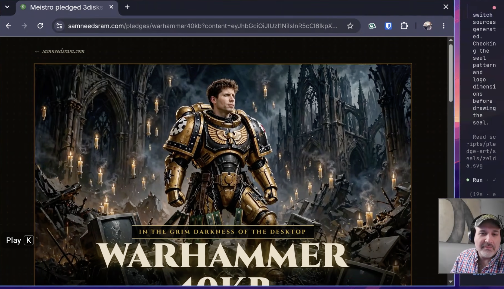

<div align="center">

# SAM NEEDS RAM.COM

### Somewhere in San Francisco, an AI is buffering.

<br>

## 👉 [**samneedsram.com**](https://samneedsram.com) 👈

**[https://samneedsram.com](https://samneedsram.com)**

<br>

*Sam's out of memory. Help him remember.*

*The superintelligence must feed.*

</div>

---

## 📺 Watch the telethon

[](https://youtu.be/5qPAYRzlRsA?si=0KGTrn3kHdwx_V2d)

**[▶ Watch on YouTube](https://youtu.be/5qPAYRzlRsA?si=0KGTrn3kHdwx_V2d)**, then go to **[samneedsram.com](https://samneedsram.com)** and pledge something. Anything. The 2GB DDR2 stick from 2009 is fine. Sam isn't proud.

---

## The situation

Sam Altman needs memory. You have memory. It's in a drawer, next to a dead remote and 14 cables nobody can identify.

This site fixes that:

1. **Pledge your old sticks.** RAM, floppies, or USB drives, with a quantity and a eulogy (140 characters, make it count).
2. **Pick a theme.** Sixteen of them. Yes, sixteen. More are on the way.
3. **Get your pledge page.** It's a permanent link with its own share card, so everyone can see what you gave up for the drive.
4. **Mail it.** Totally optional. The kit goes to OpenAI's public corporate address only. Nobody's checking. Sam's counting on the honor system, and honestly, so are we.

### What we take

If it once held data, Sam wants it.

| Kind | Types | How many |
|---|---|---|
| 🟩 RAM sticks | DDR2, DDR3, DDR4, DDR5, SODIMM | up to 512 GB |
| 💾 Floppies | 3.5" HD, 3.5" DD, 5.25" HD (we're not snobs) | 1 to 500 disks |
| 🔌 USB sticks | USB-A, USB-C, Mini, Mystery | up to 1024 GB |

"Mystery" is for the stick with no label that you're afraid to plug in. Sam will plug it in.

---

## The themes (the part we're proud of)

Every pledge page wears a costume. There's a Ramageddon where the data center burns, a Warhammer 40KB where a floppy is held like a holy relic, a Gondor where the beacon is lit with a suspiciously RAM-shaped flame, plus SeverRAM, The Legend of RAM, 1.21 Gigabytes, PokeRAM, RAMbusters, RAM Trek, Daft RAM, TetRAM, Stranger DIMMs, Pickle RAM, and You've Got RAM. Retired themes (rest in peace, This Is Fine) leave the picker, but their old links work forever, because we respect the dead.

Each theme ships with its own hero art, share card, seal, stylesheet, copy, and test. Sam is in every one of them, in character, holding RAM.

### Nobody builds these by hand

Two skills in [`.agents/skills/`](.agents/skills/) make all of it. They work **independently and continuously**. Neither knows the other exists. They share one folder, `docs/planning/ideas/`, like roommates who communicate only through the fridge.

```
 generate-theme-idea                          generate-theme-template
 "what if Sam, but in a ___?"                 "I will build it. All of it."
 (fills the fridge, any time)                 (empties the fridge, nonstop)
          │                                              ▲
          ▼                                              │
  docs/planning/ideas/<slug>.md  ───── oldest first ─────┘
                                                         │
                     moves to ideas/done/  ◀─────────────┤
                                                         ▼
          html + css + art + seal + test + themes.json
          → green npm test → commit → push → next idea → next idea → ...
```

Feed it ideas and a stream of finished, tested, shipped themes comes out. Nobody has to supervise each one. We just stand back and watch the pledge pages multiply.

### 🧠 `generate-theme-idea`: the idea machine

Writes a concise, buildable idea file to `docs/planning/ideas/<slug>.md`, one at a time or in a whole batch. No code, no art, just vibes with a spec.

- **Picks the premise itself.** Name a franchise and it'll use it. Otherwise it raids geek culture, movies, shows, games, memes, and retro tech, and doesn't ask permission.
- **Never repeats itself.** It checks `ideas/` *and* `ideas/done/` before writing, and rotates the source so you don't get nine movie themes in a row.
- **Titles must be puns.** `Warhammer 40KB`, `Ramageddon`. Never the bare franchise name. The title sits in the picker next to fifteen others and has to win a fight.
- **Fixed structure.** Title and logline, a **Premise** (played dead straight), **Theme instructions** (voice, palette, type, art direction for hero, og, picker, and seal, plus the hero title, eyebrow, letter angle, share-card line, and hashtag), and **Spec notes** for the next skill.
- **Sam stars in every hero and share image,** in character. Zuckerberg, Elon, and Jensen Huang may guest. Nobody else without Kris's OK.
- **Knows its place.** It writes the file, reports the path, and does not build anything or commit anything.

### 🔨 `generate-theme-template`: the builder that doesn't sleep

Grabs the oldest pending idea and builds the entire theme. Then it grabs the next one. Then the next one.

1. **Claim the idea.** It never asks which one. Oldest file wins, and it gets moved to `ideas/done/` to mark the claim. Empty queue? It stops and says so.
2. **Generate the art.** Hero, og, and picker, via image generation, with face likeness taken from reference portraits.
   - The hero leaves a plain dark safe area for the title. No painted stripes, which look like glitches.
   - Sam's face must stay out from under the text.
   - **A recognizable RAM stick must be in the frame:** green PCB, gold pins, black chips. A generic glowing tech backdrop with no readable hardware fails and gets regenerated. This is a RAM site.
   - No text baked into any image.
3. **Draw the seal.** A 512 viewBox SVG, transparent, no text. The template adds the seal word in HTML.
4. **Run `npm run pledge-art -- <slug> ...`.** It enforces the size table and stamps the logo on the share image. Every line must say OK.
5. **Look at everything.** Does the motif survive its crop? Is the logo covering a face? Does the seal ring render?
6. **Write the CSS.** Mobile-first, 640px breakpoint, print stylesheet, system-font fallback, overlay anchored away from Sam's face.
7. **Write the template.** Valid HTML5, the required meta block, absolute asset paths, only allowlisted `{{markers}}`, and copy that reads right whether you're donating RAM, floppies, or USB sticks. Deadpan the whole way down.
8. **Prove it.** A per-theme test pins the art, fills RAM and floppy pledges with and without a eulogy, and checks for leftover markers. Screenshots at desktop and 390px mobile, then the full `npm test`.
9. **Register last.** Only after everything passes does the theme get added to `public/pledges/themes.json`, then the tests run again.
10. **Land it and keep going.** Tests green, Conventional Commit, push to `main`, straight back to step 1. It never commits on red.

The full contract (markers, art dimensions, registry rules) lives in [docs/pledge-pages-spec.md](docs/pledge-pages-spec.md).

---

## Under the hood

- **Next.js 16** (App Router) and **React 19**
- **Static HTML templates with markers.** The server fills in each pledge page, meta tags included, so social crawlers get the share card without running JavaScript
- **Signed pledge links.** HMAC-SHA256 JWTs from `node:crypto`, zero dependencies, no expiry. Your pledge outlives us all
- **Google Firestore** via Application Default Credentials
- **Puppeteer** and **sharp** for art processing
- **Cloud Run**, deployed from GitHub Actions on every push to `main`, secrets in Secret Manager
- **Node's built-in test runner,** with a test for every theme

### Run it locally

```sh
npm install
export PLEDGE_JWT_SECRET="any-32-char-string-for-local-dev!"
export SITE_URL="http://localhost:3000"
npm run dev
```

Open http://localhost:3000. The pledge flow only needs those two variables. `/api/health` also wants `gcloud auth application-default login`.

| Command | What it does |
|---|---|
| `npm run dev` | Dev server (embeds the HTML templates first) |
| `npm run build` | Production build |
| `npm start` | Serve the production build |
| `npm test` | Run the tests. All of them. Before every commit |
| `npm run embed-html` | Bundle `html/` templates into `lib/pages.generated.js` |
| `npm run pledge-art -- <slug> ...` | Process and size-check a theme's art |
| `npm run build-favicon` | Regenerate favicons |

### Where things live

```
app/                    Routes: homepage, /pledges/[theme], /api/*
html/pledges/           One template per theme (not served raw)
public/pledges/         Per-theme CSS and art, plus themes.json (the registry)
scripts/pledge-art/     Seal SVGs and art processing
tests/                  Pledge logic tests plus one test per theme
lib/                    Validation, signing, template filling, Firestore client
docs/planning/ideas/    The idea queue (done/ holds the ones already built)
.agents/skills/         The theme machines
```

### Deploying

Push to `main` and it ships to Cloud Run via [GitHub Actions](.github/workflows/deploy.yml). Setup, Firestore, and secrets are in [docs/deploy-gcp.md](docs/deploy-gcp.md).

### More docs

- [docs/pledge-pages-spec.md](docs/pledge-pages-spec.md): how pledge pages and templates work
- [docs/deploy-gcp.md](docs/deploy-gcp.md): deployment
- [docs/da_plan.md](docs/da_plan.md): the original plan
- [AGENTS.md](AGENTS.md): house rules for the robots

---

## Hackathon

Built for the **Meta Global AI Developer Hackathon 2025**, entered in the Indie and Viral categories.

<div align="center">

**[samneedsram.com](https://samneedsram.com)**

*Feed the SI.*

</div>

## License

See [LICENSE](LICENSE).
